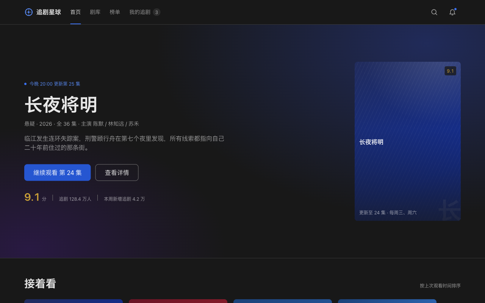
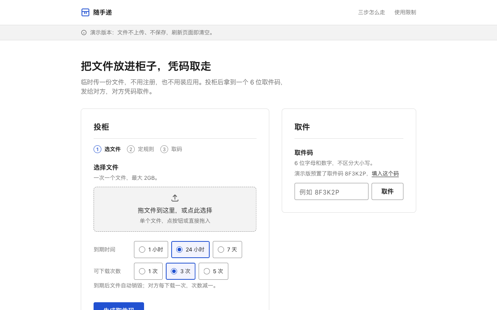
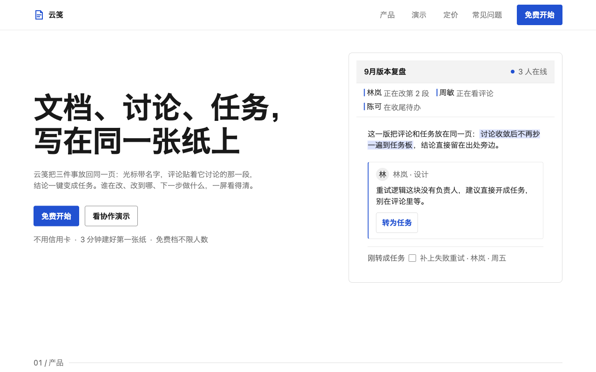
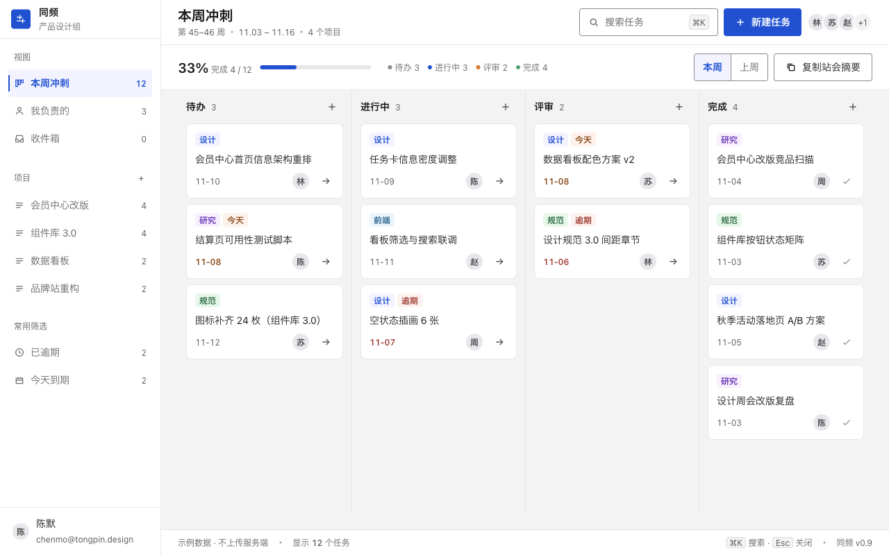

# UISpecs · UI 设计规范全文库

给 AI 用的 UI 设计规范原文库。十八个分区，四百来篇官方规范与设计文章，收的全是带出处的原文。

AI 设计界面时容易凭记忆编数值，字号随手 16px、间距随手 10px。这里每个值都能回到原文的 `文件:行号`。

> [!WARNING]
> 项目还在测试阶段，按本库出稿的效果不稳定，别直接拿去交付。

> [!IMPORTANT]
> 引用规范，不是照抄布局。数值以库内原文为准，一个项目只选一个基准规范。界面布局按项目自己的信息架构设计，阅读站是本库自己的皮肤，不要照抄。

## 怎么用

把下面这段发给 AI，它会按规范库取值出稿。`<站点地址>` 换成阅读站地址。

```text
<!-- AI-PROMPT:START 由 site/scripts/sync-readme-prompt.mjs 生成，勿手改 -->
你要按 UI 设计规范出界面稿，数值禁止凭记忆编造，一切取值以 UISpecs 规范库原文为准：

1. 定语境：先定产品语境（中文后台 / 公共服务 / 开发者工具 / 品牌官网），它决定第 5 步选哪个基准规范。改版、重构、给本库自己改站也算项目，同样要选基准规范。判据：一句「产品类型 + 基准规范」写进取值记录。
2. 拉指南包：拉 <站点地址>/ai/design-points.json（在本仓库干活读 site/dist/ai/design-points.json，没构建读 site/src/data/star-points.json），一次拿到 usage、guide、method_required、设计场景与设计点，不整库翻目录。判据：usage、guide、method_required、tasks 与 points_by_task 四样都在手上。
3. 选设计点：先读方法层必读三篇原文（界面配色框架、视觉层级、布局模式），再选点；value_notes 只是坐标，不拥有数值决定权。判据：方法层三篇读过，选点清单带 id 与 articles。
4. 读原文取值：按设计点给出的文章（端点 /md/<path>）读 2 到 5 篇全文，把要用的值连 文件:行号 记进取值记录（引用一律 content/ 完整路径，缩写不算出处）。判据：每个值有行号；组合再查一遍，同一段间距只有一层来源、相邻元素按刻度、多栏先定栏距与正文列余量。单值合规不等于组合合规。
5. 项目选型：按项目选型方案（产品语境 → 基准规范）选出基准规范：一个项目只认一个基准规范，它拥有数值决定权，其他来源只取原则；基准规范缺的维度按「基准规范缺口与派生」回源或走兜底档，例外记取值记录；可访问性底线高于风格。改版项目同样先定基准规范。判据：取值记录写明基准规范名，跨源数值为零。
6. 出稿分工：结构交给 hallmark（版式、防模板化检查），数值与本库原文对齐，进 token 不写裸值；数值点的 checks 自测题逐题自查。判据：裸值为零，自测题全过，出处随稿附上。
7. 测试回炉：用浏览器自动化逐个真点（表单校验、筛选、导航、弹窗、主题切换），量 320 / 375 / 768 / 1280 四档宽度与溢出，对比度实测。判据：交互清单逐条有结果，四档无溢出；不通过回第 3 步补点或第 4 步重取值，不许改设计点硬凑。

另：站点命名走 NameYouLike 口径（起名提示词与核验：https://github.com/hey-yx/NameYouLike），英文产品名、绑产品事实、落一次真实碰撞检索，结果记进取值记录；图表用成熟图表库，纯测试页内联 SVG 即可。
<!-- AI-PROMPT:END -->
```

不想发给 AI 就自己翻：`content/` 里按分区存成 Markdown，打开就能读。

## 站点

首页是入口，给出全库统计和十八个分区，顶栏是四件事：案例、需求、指南、按分区读。

| 页面 | 上面有什么 |
| ---- | ---- |
| `/s/<分区>/` | 该分区的全部条目，带来源 |
| `/a/<分区>/<文件名>/` | 文章全文，标出来源、字数和采集日期，附原文 Markdown 与 JSON |
| `/starmap/` | 指南：设计地图把设计场景和设计点连起来，可筛选，点开看选点标准和该读的文章；同页有七步流程和可复制的提示词 |
| `/examples/` | 十一个案例，每张卡给主色、结构、版型，能打开成品、需求、DECISIONS、FINDINGS |
| `/briefs/` | 十一个案例的建站需求，可整份下载 |

顶部搜索框或 ⌘K 搜全文，右上角切主题：自动、亮、暗。统计数字以首页为准。

给机器读的：`/catalog.json` 全库目录，`/ai/design-points.json` 指南包，`/ai/guide.md` 与 `/ai/guide.json` 指南文本，`/ai/case-briefs.json` 建站需求，`/md/<路径>.md` 单篇原文。

## 库里有什么

十八个分区：页面设计实操、Bento Grid、写作与排版、设计 Token、Web 标准、品牌设计语言、图标、色彩、字体排版、布局与间距、动效、无障碍、组件设计、场景模式、版型原型、数据可视化、文案与设计价值观、案例与拆解。

来源以官方规范优先：W3C、Apple HIG、Polaris、Primer、Carbon、Spectrum、USWDS、GOV.UK、NHS、Atlassian、Ant Design、TDesign。也收 NN/g、web.dev、Every Layout、Practical Typography 这类文章。每篇的原始地址和抓取日期写在文件头，只收全文，细则见 [content/README.md](content/README.md)。

已知例外：`content/brands/designmd--slack.md` 上游是第三方再创作，不是 Slack 官方规范。

## 设计案例

生成案例是验收手段：看 AI 学没学会，就看成品里每个数值能不能给出 `文件:行号`。

十一站都在 [`examples/`](examples/)，单文件 HTML，不请求外部资源，文案是真实中文。十站用 TDesign 作基准规范，payloaddeck 走 Primer。每站的 `DECISIONS.md` 记数值出处，`FINDINGS.md` 记基准规范覆盖不到的量怎么补，做法见 [`examples/README.md`](examples/README.md)。

<p align="center"></p>

## 目录

```text
content/   全文（唯一真源）
briefs/    建站需求
examples/  十一个案例
site/      Astro 站点
```

## 本地运行

```bash
cd site
npm install
npm run dev      # 改 content/ 即热更新
npm run build    # 产出 site/dist/
```

上线用 `SITE_URL=https://你的域名 npm run build`，页面里的链接、分享卡片和 sitemap 都按它生成。加文章按 [content/README.md](content/README.md) 走，构建会校验 frontmatter、id 和所有文章引用，出错直接失败。
