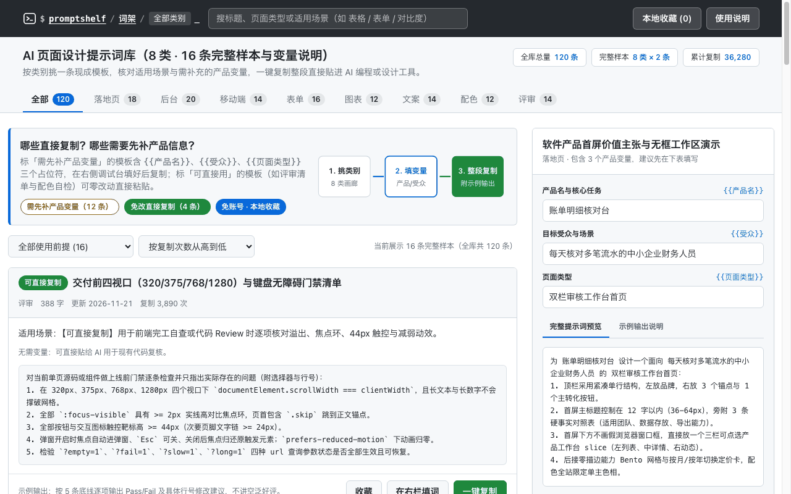
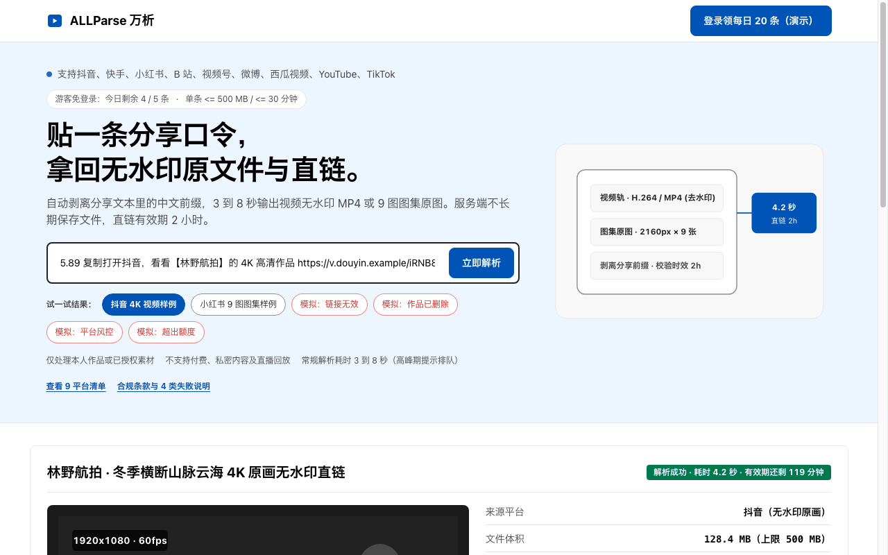

  

# UISpecs · UI 设计规范全文库

给 AI 用的 UI 设计规范原文库。收官方规范全文，每个页面数值都能定位到文章具体行号。

AI 凭记忆写界面时，字号随手 16px、间距随手 10px，交付前查不出对错。这个库把每个取值的依据钉在原文行号上，按产品类型自动匹配官方设计体系出稿。

## 怎么用

1. 先确保你的 AI 编程工具已加载本库配套的 4 个 skill（`hallmark`、`ui-ux-design`、`interfaces`、`impeccable`）：可从本仓库 [`skills/`](skills/) 目录直接复制到本机 Agent 的 skill 目录（如 `~/.agents/skills/` 或 `~/.hermes/skills/`），分工与上游来源见 [skills/README.md](skills/README.md) 与 [skills/SOURCES.md](skills/SOURCES.md)。
2. 提示词以 [`site/src/data/guide.ts`](site/src/data/guide.ts)（`AI_PROMPT`）为唯一来源：打开已部署阅读站首页点击「复制提示词」按钮，或直接读取 [`/ai/guide.json`](/ai/guide.json) 的 `ai_prompt` 字段，在末尾附上你的产品或页面需求发给 AI 即可。

## 收录范围

- **7 套官方设计体系**：TDesign（腾讯）、Carbon（IBM）、Polaris（Shopify）、Primer（GitHub）、Spectrum（Adobe）、Fluent 2（Microsoft）、Apple HIG，按产品形态自动分流，每个项目只认一套作唯一数值源。
- **标准与实战方法**：W3C / WCAG、NN/g、web.dev、Every Layout 等规范与方法全文，缺失维度按统一规则回源补齐。

## 设计案例

以下是 AI 按本库流程生成的实测首屏效果，完整案例与取值出处见 [`examples/`](examples/)：

## 仓库目录

- [`content/`](content/)：官方设计规范与方法原文（收文规则见 [content/README.md](content/README.md)）
- [`examples/`](examples/) 与 [`briefs/`](briefs/)：实测案例成品（含取值溯源）与对应建站需求
- [`skills/`](skills/)：配套设计与评审 skill（分工见 [skills/README.md](skills/README.md)）
- [`site/`](site/)：配套阅读站源码

## License

本项目基于 [MIT](LICENSE) 协议开源，`content/` 中收录的第三方设计规范原文版权归原发布方所有；`skills/` 中引入的第三方 skill 保留其各自原协议声明（见 [skills/SOURCES.md](skills/SOURCES.md)）。
