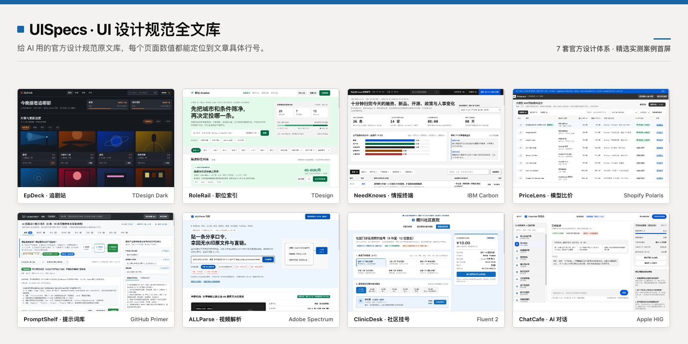
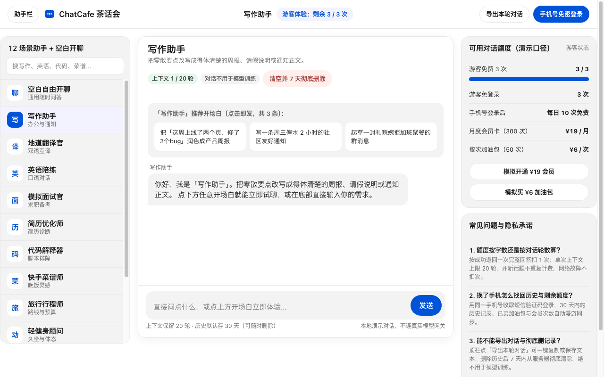

<p align="center">
  
</p>

# UISpecs · UI 设计规范全文库

给 AI 用的 UI 设计规范原文库。收官方规范全文，每个数值都能回到原文的 `文件:行号`。

AI 凭记忆写界面时，字号随手 16px、间距随手 10px，交付前查不出对错。这个库把每个取值的依据钉在原文行号上。

> [!WARNING]
> 项目还在测试阶段，按本库出稿的效果不稳定，别直接拿去交付。

> [!IMPORTANT]
> 库内规范原文的版权归各官方体系与原作者，引用时连出处一起给。本站自己的版式不外借。

## 能做什么

- 每个项目只认一套官方规范当基准，数值冲突有裁决规则，缺的维度说明怎么补。
- 按场景或具体问题挑要用的规范条目，每条直接指到该读的原文。
- 从定项目类型到出稿自测的分步流程，每步都写了怎么算做完。
- 首页标题右侧可点「复制提示词」，整段粘贴给 AI，它就按这个库出稿；完整流程与按需接口说明见 `/ai/guide.md`。
- 案例成品当验收：每个数值都标了原文的 `文件:行号` 出处。

来源以官方规范优先：W3C、Apple HIG、Fluent 2、Carbon、Polaris、Primer、Spectrum、TDesign 等，也收 NN/g、web.dev、Every Layout 这类文章。每篇的原始地址与采集日期写在文件开头，收文规则见 [content/README.md](content/README.md)。

## 页面

首页展示全库统计、提示词入口与分区列表，顶栏三个入口：案例、需求、地图。

| 页面 | 上面有什么 |
| ---- | ---- |
| `/s/<分区>/` | 该分区的全部条目，带发布方、篇幅与来源 |
| `/a/<分区>/*/` | 文章全文，标出发布方、字数与采集日期，可下载原文 Markdown 与 JSON |
| `/starmap/` | 设计地图：分区 × 场景矩阵，按场景查设计点并展开对应原文与选型方案 |
| `/examples/` | 案例成品，每站标出主色、结构与版型，可打开成品页与 DECISIONS / FINDINGS 记录 |
| `/briefs/` | 各站的建站需求，可下载原文 Markdown；已有成品的站可直接跳到成品与记录页 |

顶部搜索框或 ⌘K 搜全文。给 AI 读的按需轻端点：`/ai/routing.json`（总路由、7 套选型摘要与最近避重记录）、`/ai/points/<id>.json`（单设计点）、`/ai/reference-screens.json`（参考首屏件位与密度）、`/md/<路径>.md`（单篇原文）；全量端点仍保留：`/catalog.json`、`/ai/design-points.json`、`/ai/guide.md`、`/ai/guide.json`、`/ai/case-briefs.json`。

## 设计案例

案例是验收手段：看 AI 学没学会，就看成品里每个数值能不能给出 `文件:行号`。

<p align="center"></p>

成品集中在 [`examples/`](examples/)，均为单文件 HTML，覆盖 [`briefs/`](briefs/) 中的建站需求。没开框架的站不请求任何外部资源，开了框架的站只从公共 CDN 引 React 或 Vue 的组件库。各站按产品同构分流到 TDesign、Carbon、Primer、Polaris、Spectrum、Fluent 2、Apple HIG 七套官方体系，外壳（页底色、顶栏、页脚）按 [`briefs/layouts.md`](briefs/layouts.md) 与 `scripts/check-frame.py` 批内避重，取值出处由 `scripts/check-ledger.py` 核对。站点列表、缺口补齐方式与验收口径见 [`examples/README.md`](examples/README.md)。

## 项目内 skill

项目自带四个设计 skill，在 [`skills/`](skills/)：生成层 Hallmark（新形状与防模板化）与 UI/UX Design（状态、ARIA 与信息架构），评审层 Interfaces（七域与改动评审）与 Impeccable 文档层（底线量规）。分工、许可与同步方式见 [`skills/README.md`](skills/README.md)。本机安装只是运行缓存，换机器以仓库副本为准。

## 本地运行

```bash
cd site
npm install
npm run dev      # 改 content/ 即热更新
npm run build    # 产出 site/dist/
```

上线时用 `SITE_URL=https://你的域名 npm run build`，页面链接、分享卡片和 sitemap 都按它生成。服务器要让 `.md` 与 `.json` 按 UTF-8 返回，否则中文会显示成乱码。加文章按 [content/README.md](content/README.md) 走，格式或引用不对，构建会直接报错。
